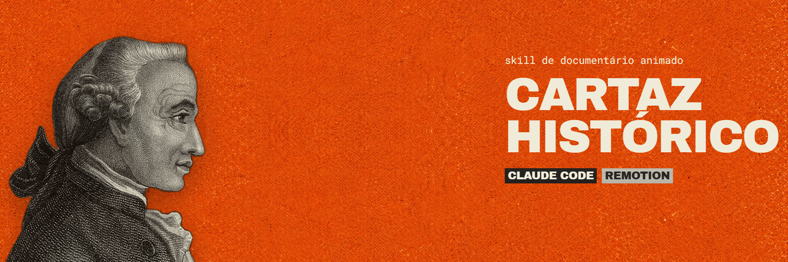
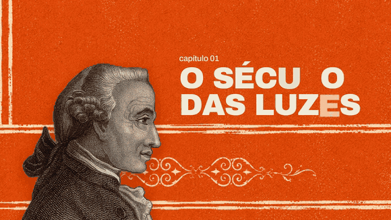
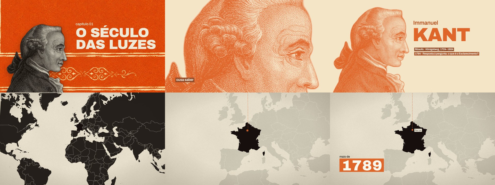
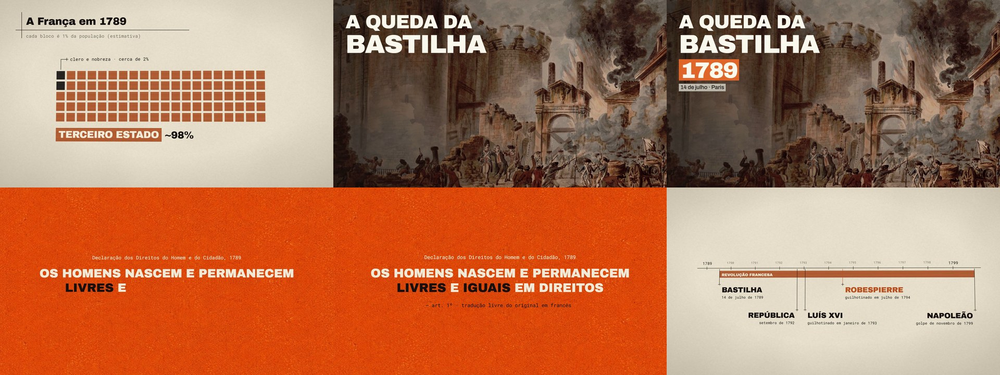
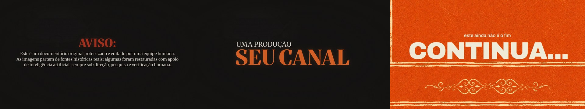

<p align="center">
  
</p>

<h1 align="center">Cartaz Histórico: skill de documentário animado para Claude Code + Remotion</h1>

<p align="center">
  Cubra cerca de 80% de um mini-doc com animação editorial sincronizada à fala: colagem em papel creme e laranja, pinturas de época recriadas com fidelidade, mapas, linhas do tempo e citações em máquina de escrever.
</p>

<p align="center">
  <a href="https://ojosuevfx.github.io/cartaz-historico-motion/"></a>
  <a href="LICENSE"></a>
  
  
</p>

<p align="center">
  
</p>

## O que é

Uma [skill](https://docs.claude.com/en/docs/claude-code/skills) que ensina o Claude Code a animar documentários narrados neste estilo. Com a montagem pronta no Premiere, ela transcreve por palavra, decupa cada fala num tipo de cena, confere nomes e datas, reúne imagens de fontes reais, anima em [Remotion](https://www.remotion.dev/) e devolve as animações em camadas com alfa, cada uma no seu tempo na timeline.

Ela nasceu de um mini-doc real de 35 minutos, com 87% da timeline animada. As regras vieram das correções feitas durante esse trabalho.

- **Fonte sempre real:** pintura, foto ou documento do próprio fato, recriado com fidelidade. Nada de imagem genérica de IA.
- **Sincronia por palavra:** cada texto entra na palavra falada, com os tempos do Whisper.
- **Colagem editorial:** papel creme, laranja queimado e preto, com grotesca pesada que entra letra a letra.
- **Texto limpo:** nunca em cima de rosto, nunca um texto sobre o outro, sem desfoque para abrir espaço.
- **Camadas no editor:** ProRes 4444 com alfa, em trilha própria, e ligação opcional ao After Effects por Dynamic Link.

## O que dá para fazer

| A fala traz | Cena |
| :--- | :--- |
| Pessoa | Retrato pintado em tela cheia, serigrafia que recua com o nome atrás, medalhão, recorte sobre creme |
| Várias pessoas | Painel de grupo, com as figuras em P&B |
| Lugar | Mapa do mundo ou de regiões, com nomes de época e câmera colada que recua |
| Data ou acontecimento | Pintura de época com título e anos em blocos |
| Fatos encadeados | Linha do tempo com régua, barra e marcos |
| Documento ou trecho lido | Papel inclinado, marca-texto na palavra falada, fonte na tela |
| Citação | Máquina de escrever sobre o cartaz laranja |
| Conceito ou dado | Blocos contáveis e fios que se desenham, num palco 3D |
| Troca de assunto | Card de capítulo |
| Início e fim | Aviso inicial e card "Continua" |

<p align="center">
  
  
  
</p>

## Instalação

Clone na pasta de skills do Claude Code:

```bash
git clone https://github.com/ojosuevfx/cartaz-historico-motion.git ~/.claude/skills/cartaz-historico-motion
```

Ou use o instalador, que também atualiza uma instalação existente.

macOS, Linux ou Git Bash:

```bash
curl -fsSL https://raw.githubusercontent.com/ojosuevfx/cartaz-historico-motion/main/install.sh | bash
```

Windows, no PowerShell:

```powershell
irm https://raw.githubusercontent.com/ojosuevfx/cartaz-historico-motion/main/install.ps1 | iex
```

Reinicie o Claude Code depois de instalar.

### O que mais você precisa

| Para | Ferramenta |
| :--- | :--- |
| Animar e renderizar | [Node.js](https://nodejs.org/) e [ffmpeg](https://ffmpeg.org/) |
| Transcrever por palavra | [Whisper](https://github.com/openai/whisper) ou [whisper.cpp](https://github.com/ggml-org/whisper.cpp) |
| Recortar figuras | Python com `rembg`, `opencv-python` e `pillow` |
| Recriar imagens | Um gerador de imagens que aceite referência. O doc original usou o ChatGPT no navegador |
| Montar as camadas sozinho | Premiere Pro com um servidor MCP. Sem isso, a skill entrega os `.mov` com o tempo no nome, e você coloca à mão |
| Acabamento opcional | After Effects. O halftone original usa Sapphire, um plugin pago |

## Como usar

Abra o Claude Code na pasta do projeto, com a montagem aberta no Premiere, e peça:

> Anima este mini-doc no estilo cartaz histórico. Cobre uns 80% da timeline e deixa o apresentador nos momentos pessoais.

Ou, para peças soltas:

> Faz um card de capítulo no estilo cartaz histórico com o título "A Queda".

> Faz o aviso inicial do doc no estilo cartaz histórico, com a assinatura do meu canal.

## Usar o kit sem a skill

```bash
cp -R references/motor meu-doc && cd meu-doc
npm install --legacy-peer-deps
npx remotion studio
```

| Arquivo | Para quê |
| :--- | :--- |
| `src/kit.tsx` | Paleta, curvas, papel, `NomeLetras`, `Etiqueta`, `AnoBloco`, cena em corte seco |
| `src/colagem.tsx`, `src/palco.tsx` | Peças das explicações e câmera 3D contínua |
| `src/cenas/` | Capítulo, retratos, serigrafia, painel, mapas, evento, documento, citação, linha do tempo, aviso, continua |
| `src/Molde.tsx` | Ponto de partida de um capítulo |
| `src/Demo.tsx`, `src/Exemplos.tsx` | A demo inteira e uma cena de cada componente restante |
| `tools/` | Lista de trechos, render em camadas, folha de contato e comps do After |

## Limites conhecidos

- Só foi usado em 1920×1080, 30 fps. O formato vertical não foi testado.
- O render final é pesado: o doc de 35 minutos levou cerca de 3 h e 156 GB, com GPU, em ProRes 4444 XQ a 1080p.
- O halftone do acabamento não vem no kit. Ele é aplicado no After Effects com um plugin pago, e é opcional.
- A automação do Premiere e do After foi testada no Windows, no Premiere 26.5 e no After Effects 2026.
- A recriação de imagens depende de um gerador externo, que às vezes inventa em vez de recriar. Compare cada resultado com a obra. As amostras daqui usam as obras reais, tratadas só com recorte, crop e duotone.

## Licença e créditos

Código e skill sob [MIT](LICENSE). O Remotion tem [licença própria](https://www.remotion.dev/license), que pode exigir licença paga para empresas: confira antes de usar comercialmente. As fontes são distribuídas sob licenças abertas, e as imagens de demonstração têm autoria e licença próprias, listadas em [CREDITOS.md](CREDITOS.md). Antes de publicar um vídeo, confira os direitos das imagens que você usar.

---

## English

**Cartaz Histórico** ("historical poster") is a [Claude Code](https://docs.claude.com/en/docs/claude-code) skill and [Remotion](https://www.remotion.dev/) kit for animated history documentaries. It covers about 80% of a narrated edit with voice-synced editorial collage: cream paper, burnt orange and black, period paintings faithfully recreated from real sources, kinetic typography, maps, timelines, typewriter quotes and chapter cards. It delivers ProRes 4444 overlays with alpha to Adobe Premiere Pro, with an optional Dynamic Link to After Effects.

The skill's instructions and on-screen examples are in Brazilian Portuguese. Install with the `git clone` command above and ask Claude Code to animate your documentary in the "cartaz histórico" style. Released under the MIT license; Remotion has [its own license](https://www.remotion.dev/license).

Criado por [Josué Ribeiro](https://github.com/ojosuevfx).
